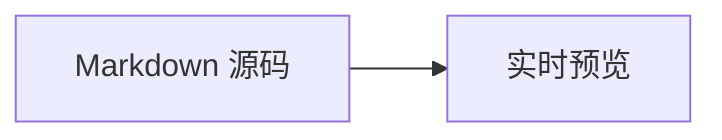

# 欢迎使用 Inkstone

> [!TIP] 先知道这五件事
> - 这是你的 Markdown 笔记本，正文始终是普通文本。
> - 笔记、附件、字体和设置保存在手机本机，不需要账号或网络。
> - 内容会自动保存，手机断网时也可以编辑和整理笔记。
> - 笔记顶部标题可以独立编辑，不必与正文第一行相同。
> - 请定期导出完整 ZIP 备份；卸载应用或清除应用数据会删除本机笔记。

正文支持即时渲染、分栏和阅读三种方式：即时渲染中点击内容即可编辑；手机分栏上下排列；阅读模式适合专注浏览。导出的 `.md` 文件可以被普通文本编辑器打开。

## 现在就试试

- [ ] 点击这个复选框，确认勾选状态会保存
  - [ ] 子任务也能独立勾选
- [ ] 打开编辑界面，使用工具栏把文字加粗
- [ ] 写一个 `#标签`，或点击 [[我的第一篇笔记]] 创建双链笔记
- [ ] 点击笔记顶部标题，给它换一个名称
- [ ] 创建文件夹，把笔记整理进去
- [ ] 在「我的」中调整主题、字号和字体，也可以上传自己的字体文件
- [ ] 在「我的 → 数据」导出完整 ZIP 备份，选择手机上的保存位置

## 手机操作

使用底部导航切换笔记、编辑、查看和「我的」。手机系统返回手势或返回键可以关闭当前弹窗、退出子页面或返回笔记列表。编辑时无需反复手动保存。

在「我的」中可以调整界面和编辑器设置。打开笔记后，还可以使用搜索、大纲、版本历史和回收站整理或恢复内容。

## 写作与整理

:::: tabs
::: tab-item 写作
独立标题、Markdown 编辑、即时渲染、分栏预览、阅读模式、大纲、版本历史，以及自定义字体。
:::

::: tab-item 组织
文件夹、正文 `#标签`、`[[双链]]`、反向链接、关系图谱和关键词全文搜索。
:::

::: tab-item 数据与备份
本机自动保存，支持 Markdown、ZIP 和 JSON 导入导出。完整 ZIP 备份包含笔记、附件、字体及设置；JSON 不包含附件文件。
:::
::::

## Markdown 速查

每个示例标题下面，左侧是**实际效果**，右侧是可以直接复制的**对应源码**。

### 行内样式

| 实际效果 | 对应源码 |
| --- | --- |
| **粗体** | `**粗体**` |
| *斜体* | `*斜体*` |
| ~~删除线~~ | `~~删除线~~` |
| ==高亮== | `==高亮==` |
| `行内代码` | `` `行内代码` `` |

### 链接、图片与笔记关系

~~~~md-example title="普通链接"
[打开示例网站](https://example.com)
~~~~

~~~~md-example title="图片"

~~~~

~~~~md-example title="双链"
[[我的第一篇笔记|打开或创建笔记]] · [[欢迎使用 Inkstone#Markdown 速查|跳到本节]]
~~~~

~~~~md-example title="块 ID 与块引用"
这是一段可以被精确定位的内容。 ^markdown-demo

点击 [[#^markdown-demo]] 可以跳回上面这段。
~~~~

~~~~md-example title="笔记嵌入"
这段内容会在下方被再次嵌入。 ^embed-demo

![[#^embed-demo|嵌入结果]]
~~~~

~~~~md-example title="脚注"
这句话带有一条补充说明。[^markdown-footnote]

[^markdown-footnote]: 这是脚注的实际内容；点击编号可以在正文与脚注之间跳转。
~~~~

Obsidian 注释不会出现在预览中：`%% 单行注释 %%`；多行内容可用单独的 `%%` 标记包围。

### 公式与图表

~~~~md-example title="公式"
行内公式：$E = mc^2$

$$
a^2 + b^2 = c^2
$$
~~~~

~~~~md-example title="Mermaid 图表"

~~~~

### 现代块级扩展

~~~~md-example title="Obsidian Callout"
> [!NOTE]- 默认折叠并使用自定义标题
> 这里可以放说明、任务、列表或其他 Markdown 内容。
>
> > [!TIP]+ 默认展开的嵌套 Callout
> > 嵌套 Callout 使用相同语法。
~~~~

~~~~md-example title="折叠内容"
::: details [点击展开]
这里的内容会在展开折叠块后显示。
:::
~~~~

~~~~md-example title="标签页"
:::: tabs
::: tab-item 第一个标签
这是第一个标签页的内容。
:::

::: tab-item 第二个标签
这是第二个标签页的内容。
:::
::::
~~~~

~~~~md-example title="带标题、行号和高亮的代码块"
```ts title="hello.ts" line-numbers {2}
const name = 'Inkstone'
console.log(`Hello, ${name}!`)
```
~~~~

## 保存、备份与恢复

内容自动保存在本机，不会自动同步到网页或另一台设备。需要迁移时，可以通过「我的 → 数据」导出完整 ZIP，再在目标设备导入；也可以导入网页导出的 Markdown ZIP 备份。

导入 `.md` 或 `.zip` 时，在系统文件选择器中选中文件。导出时，在系统保存窗口中选择文件夹并确认保存。导入 ZIP 时，已经存在的相同笔记 ID 会跳过，不会覆盖已有笔记。

> [!WARNING] 请保留一份应用之外的备份
> 定期导出完整 ZIP 到手机文件夹，并自行复制到其他设备或存储位置。仅保存在应用内的内容，无法抵御卸载应用、清除数据或手机丢失。

使用同一签名的新版本覆盖安装，可以保留笔记。升级前仍建议先导出备份，不要为了升级而卸载旧版。

## 最后

在「我的」中调整主题、排版和编辑器，在「关于」中查看版本、源码与开源许可证。你可以保留这篇速查，也可以删除它，开始写自己的内容。 #入门
